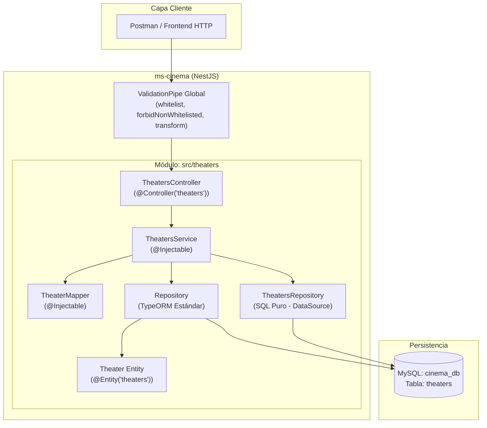
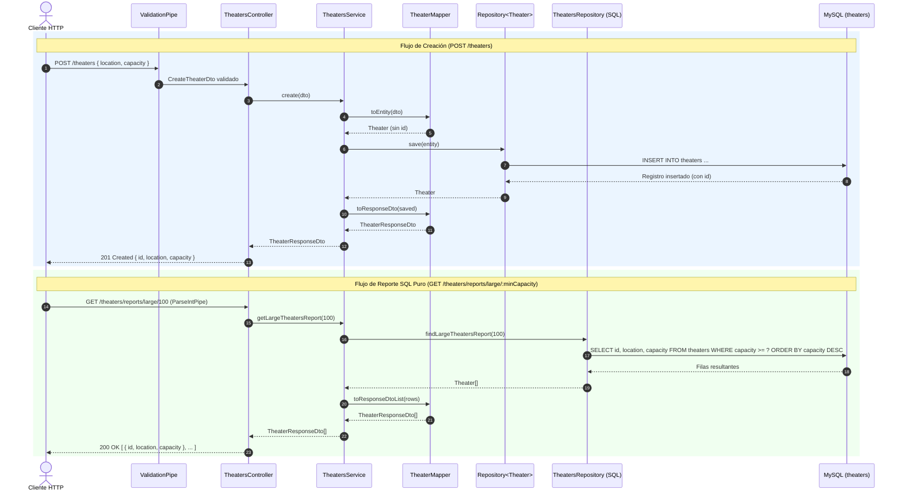

# Arquitectura y ADR 001: Módulo `Theaters` (Primer CRUD en NestJS)

**Fecha:** 2026-10-29  
**Estado:** Aceptado / Implementado  
**Módulo:** `src/theaters`

---

## 1. Visión General de la Arquitectura

El módulo `theaters` implementa una **rebanada vertical (Vertical Slice)** autocontenida dentro de `src/theaters/`, separando responsabilidades en capas bien definidas y manteniendo todos los archivos muy por debajo del límite estricto de 150 líneas.

### Diagrama de Componentes

---

## 2. Flujo de Ejecución (Secuencia CRUD + Reportes)

---

## 3. Registro de Decisiones de Arquitectura (ADR)

### ADR-001: Separación de Repositorio ORM y Repositorio de Reportes SQL
- **Contexto:** Se requiere realizar operaciones CRUD estándar sobre la entidad `Theater` y, al mismo tiempo, ejecutar consultas de reportes optimizadas en SQL puro.
- **Decisión:**
  1. Utilizar `Repository<Theater>` inyectado mediante `@InjectRepository(Theater)` exclusivamente para operaciones transaccionales del CRUD (`save`, `find`, `findOne`, `remove`).
  2. Crear `TheatersRepository` en `src/theaters/repositories/theaters.repository.ts` inyectando `DataSource` (`@InjectDataSource()`) exclusivamente para reportes SQL nativos parametrizados (`dataSource.query(..., [minCapacity])`).
- **Consecuencias:**
  - **Positivas:** Código limpio, prevención de inyección SQL mediante parámetros posicionales (`?`), cumplimiento del Principio de Responsabilidad Única (SRP) y facilidad para agregar reportes complejos sin contaminar el servicio con lógica SQL.

### ADR-002: Uso de DTOs Independientes y `TheaterMapper`
- **Contexto:** Exponer directamente la entidad TypeORM acopla la capa de persistencia con el contrato público de la API.
- **Decisión:** Definir tres DTOs (`CreateTheaterDto`, `UpdateTheaterDto` con `PartialType`, y `TheaterResponseDto`) junto con un componente `@Injectable()` `TheaterMapper` encargado de las conversiones `toEntity`, `mergeEntity`, `toResponseDto` y `toResponseDtoList`.
- **Consecuencias:**
  - **Positivas:** Desacoplamiento total entre el esquema de base de datos y las respuestas JSON; validación estricta en la entrada gracias a `class-validator` y `ValidationPipe`.

---

## 4. Auditoría de Líneas de Código (Regla `< 150 líneas`)

| Archivo | Líneas Totales | Estado |
| :--- | :---: | :---: |
| `src/theaters/entities/theater.entity.ts` | 14 | Cumple (`< 150`) |
| `src/theaters/dto/create-theater.dto.ts` | 11 | Cumple (`< 150`) |
| `src/theaters/dto/update-theater.dto.ts` | 4 | Cumple (`< 150`) |
| `src/theaters/dto/theater-response.dto.ts` | 5 | Cumple (`< 150`) |
| `src/theaters/mappers/theater.mapper.ts` | 35 | Cumple (`< 150`) |
| `src/theaters/repositories/theaters.repository.ts` | 20 | Cumple (`< 150`) |
| `src/theaters/theaters.service.ts` | 68 | Cumple (`< 150`) |
| `src/theaters/theaters.controller.ts` | 48 | Cumple (`< 150`) |
| `src/theaters/theaters.module.ts` | 15 | Cumple (`< 150`) |

