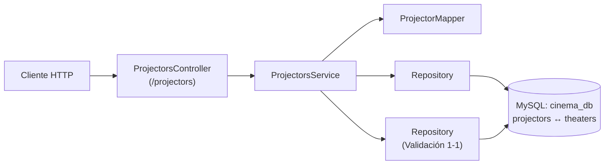
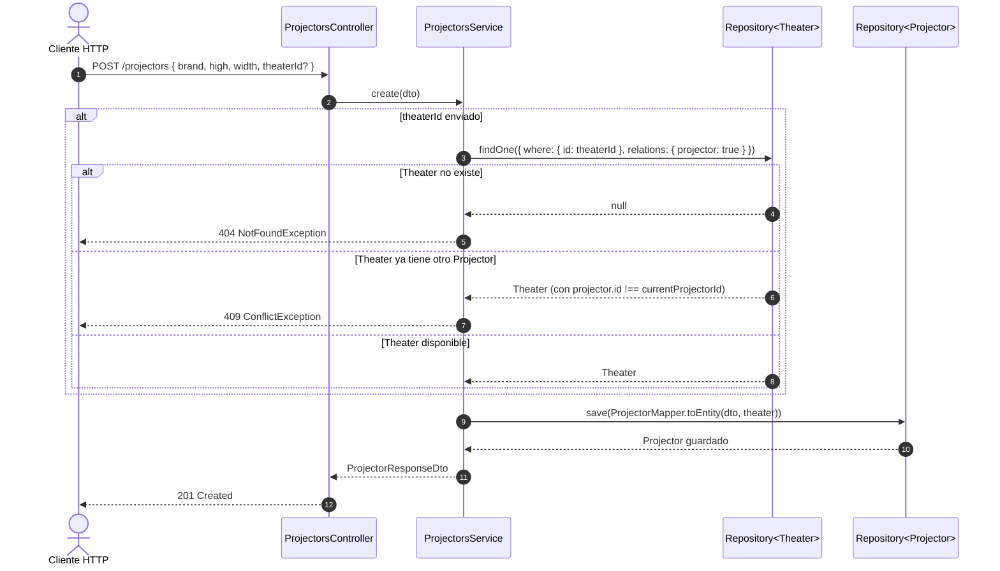

# Arquitectura y ADR 002: Relación 1-1 (`Theater` ↔ `Projector`)

**Fecha:** 2026-10-29  
**Estado:** Aceptado / Implementado  
**Módulos:** `src/projectors`, `src/theaters`

---

## 1. Diseño de la Relación Uno a Uno (1-1)

- **Lado dueño (Owner Side):** `Projector` (`src/projectors/entities/projector.entity.ts`), ya que contiene la llave foránea `theater_id` con `@JoinColumn({ name: 'theater_id' })` e índice `UNIQUE`.
- **Lado inverso (Inverse Side):** `Theater` (`src/theaters/entities/theater.entity.ts`), que referencia `projector?: Projector` mediante `@OneToOne(() => Projector, (projector) => projector.theater)`.
- **Política de integridad referencial:** `cascade: false` y `onDelete: 'NO ACTION'` para impedir el borrado accidental de un `Theater` que todavía tenga un `Projector` asignado.

---

## 2. Reglas de Negocio 1-1 en `ProjectorsService`

---

## 3. Auditoría de Líneas de Código (`< 150 líneas`)

| Archivo | Líneas | Estado |
| :--- | :---: | :---: |
| `src/projectors/entities/projector.entity.ts` | 24 | Cumple (`< 150`) |
| `src/projectors/dto/create-projector.dto.ts` | 20 | Cumple (`< 150`) |
| `src/projectors/dto/update-projector.dto.ts` | 4 | Cumple (`< 150`) |
| `src/projectors/dto/projector-response.dto.ts` | 7 | Cumple (`< 150`) |
| `src/projectors/mappers/projector.mapper.ts` | 32 | Cumple (`< 150`) |
| `src/projectors/projectors.service.ts` | 74 | Cumple (`< 150`) |
| `src/projectors/projectors.controller.ts` | 34 | Cumple (`< 150`) |
| `src/projectors/projectors.module.ts` | 13 | Cumple (`< 150`) |

