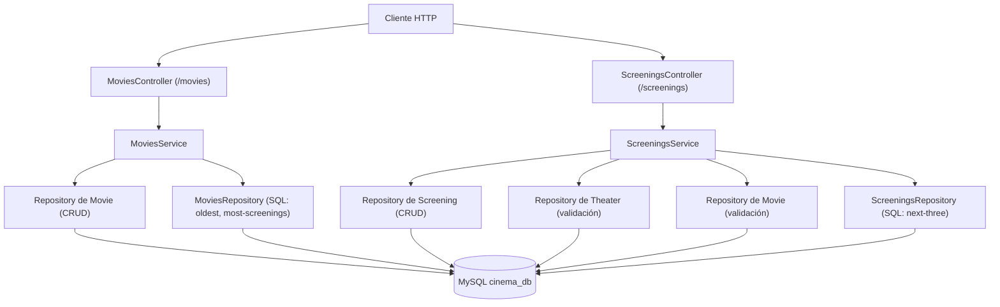
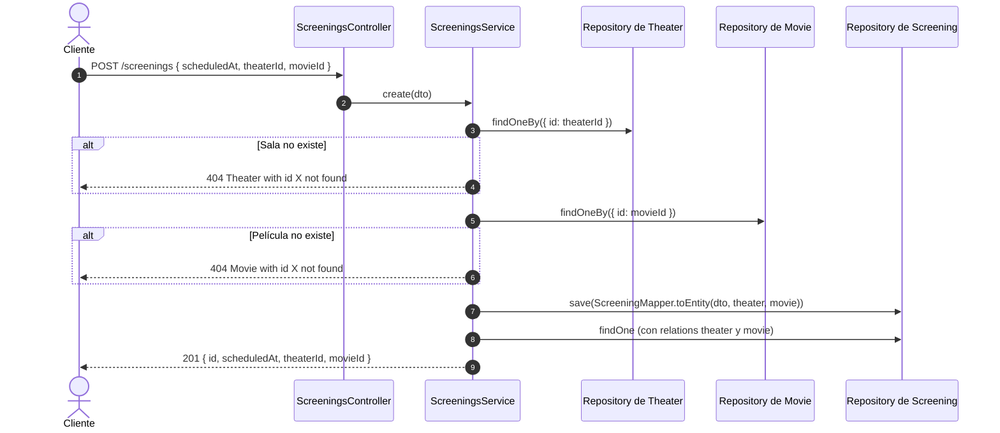

# Arquitectura y ADR 004: Relación N-N (`Theater` ↔ `Movie` mediante `Screening`)

**Fecha:** 2026-11-03  
**Estado:** Aceptado / Implementado  
**Módulos:** `src/movies`, `src/screenings`, `src/theaters`

---

## 1. Decisión principal (ADR-004)

- **Contexto:** Una película se proyecta en muchas salas y una sala proyecta muchas películas. Cada función tiene su propio dato: la fecha y hora (`scheduledAt`).
- **Decisión:** No se usa `@ManyToMany()` ni `@JoinTable()`. La relación se modela con la entidad intermedia `Screening`, que tiene dos `@ManyToOne()` (hacia `Theater` y hacia `Movie`).
- **Consecuencias:**
  - `Screening` es la dueña de las dos llaves foráneas (`theater_id`, `movie_id`).
  - `Theater` y `Movie` exponen sus funciones con `@OneToMany()` (lado inverso).
  - Con `onDelete: 'NO ACTION'`, no se puede borrar una sala o película que tenga funciones.
  - Las funciones solo se crean o editan desde `ScreeningsController`, nunca dentro del payload de `Theater` o `Movie`.

---

## 2. Diagrama de componentes

---

## 3. Flujo de creación de una función

---

## 4. Evitar ciclos en las respuestas

`ScreeningResponseDto` devuelve solo `theaterId` y `movieId` (no los objetos completos). Así, cuando `Movie` o `Theater` incluyen sus `screenings`, no se forma un ciclo de objetos anidados.

---

## 5. Auditoría de líneas (`< 150`)

| Archivo | Líneas | Estado |
| :--- | :---: | :---: |
| `src/movies/entities/movie.entity.ts` | 24 | Cumple |
| `src/movies/mappers/movie.mapper.ts` | 34 | Cumple |
| `src/movies/repositories/movies.repository.ts` | 31 | Cumple |
| `src/movies/movies.service.ts` | 67 | Cumple |
| `src/movies/movies.controller.ts` | 32 | Cumple |
| `src/screenings/entities/screening.entity.ts` | 28 | Cumple |
| `src/screenings/mappers/screening.mapper.ts` | 36 | Cumple |
| `src/screenings/repositories/screenings.repository.ts` | 20 | Cumple |
| `src/screenings/screenings.service.ts` | 88 | Cumple |
| `src/screenings/screenings.controller.ts` | 29 | Cumple |

