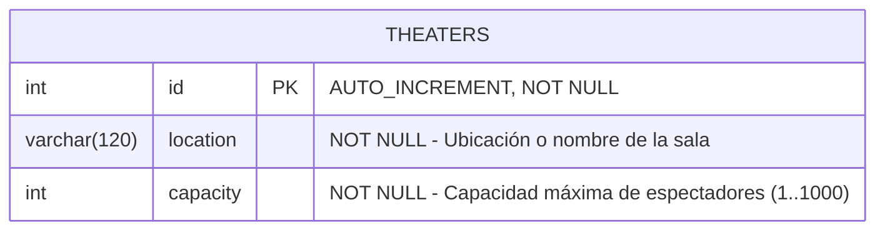

# Diseño de Persistencia y Diccionario de Datos 001: Tabla `theaters`

**Motor de Base de Datos:** MySQL (InnoDB)  
**Esquema / Base de Datos:** `cinema_db`  
**Migración Asociada:** `src/migrations/1793131308598-InitCinemaSchema.ts`

---

## 1. Diagrama Entidad-Relación (Fase 1 — Primer CRUD)



---

## 2. Diccionario de Datos: Tabla `theaters`

| Columna | Tipo SQL | Nulabilidad | Clave / Restricción | Descripción |
| :--- | :--- | :---: | :--- | :--- |
| `id` | `INT` | `NOT NULL` | `PRIMARY KEY`, `AUTO_INCREMENT` | Identificador único autogenerado del teatro/sala. |
| `location` | `VARCHAR(120)` | `NOT NULL` | Longitud máx. 120 caracteres | Nombre o ubicación física de la sala (ej. `"Sala IMAX - Centro Mayor"`). |
| `capacity` | `INT` | `NOT NULL` | Rango validado en aplicación: `1..1000` | Capacidad total de asientos disponibles en la sala. |

---

## 3. Script DDL SQL

```sql
CREATE TABLE `theaters` (
  `id` int NOT NULL AUTO_INCREMENT,
  `location` varchar(120) NOT NULL,
  `capacity` int NOT NULL,
  PRIMARY KEY (`id`)
) ENGINE=InnoDB;
```

---

## 4. Consultas SQL Nativas (`TheatersRepository`)

### 4.1 Reporte de Salas Grandes (`findLargeTheatersReport`)
Filtra las salas cuya capacidad sea mayor o igual al parámetro recibido (`minCapacity`), ordenadas de mayor a menor capacidad:

```sql
SELECT id, location, capacity
FROM theaters
WHERE capacity >= ?
ORDER BY capacity DESC;
```

---

## 5. Comandos de Migración con TypeORM

Para generar o ejecutar la migración contra MySQL (`cinema_db`):

```bash
# Ejecutar migraciones pendientes
npx typeorm-ts-node-commonjs migration:run -d typeorm.config.ts

# Revertir la última migración (si se requiere)
npx typeorm-ts-node-commonjs migration:revert -d typeorm.config.ts
```

