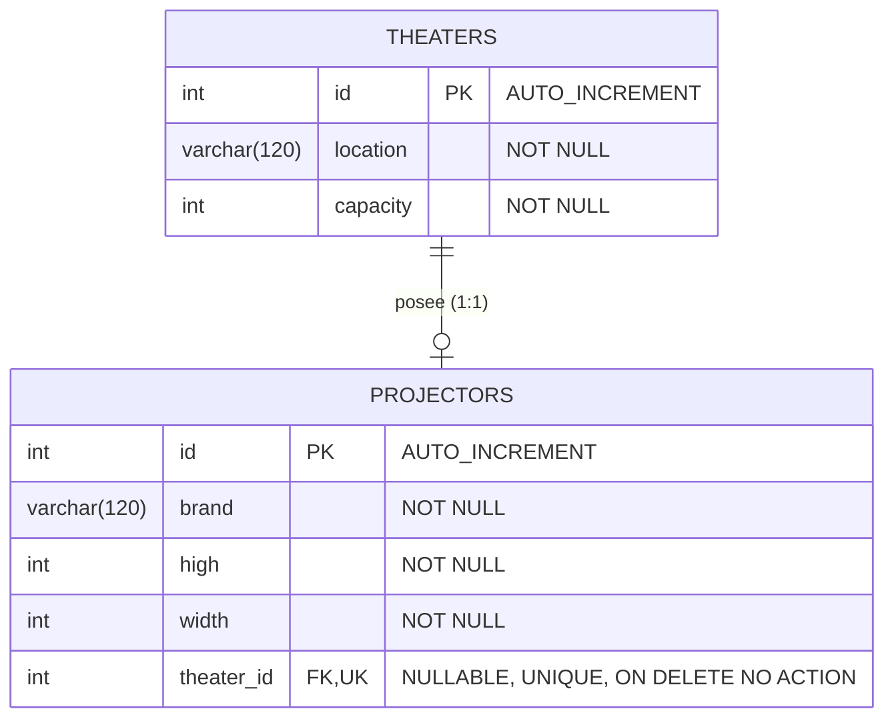

# Diseño de Persistencia 002: Tabla `projectors` (Relación 1-1 con `theaters`)

**Motor:** MySQL (InnoDB)  
**Base de Datos:** `cinema_db`

---

## 1. Diagrama Entidad-Relación (1 a 1)



---

## 2. Diccionario de Datos: Tabla `projectors`

| Columna | Tipo SQL | Nulabilidad | Clave / Restricción | Descripción |
| :--- | :--- | :---: | :--- | :--- |
| `id` | `INT` | `NOT NULL` | `PRIMARY KEY`, `AUTO_INCREMENT` | Identificador único del proyector. |
| `brand` | `VARCHAR(120)` | `NOT NULL` | Longitud máx. 120 | Marca del proyector (ej. `"Epson"`, `"Sony"`). |
| `high` | `INT` | `NOT NULL` | `>= 1` | Resolución vertical en píxeles (ej. `1080`). |
| `width` | `INT` | `NOT NULL` | `>= 1` | Resolución horizontal en píxeles (ej. `1920`). |
| `theater_id` | `INT` | `NULL` | `UNIQUE`, `FK -> theaters(id)`, `ON DELETE NO ACTION` | Sala asociada (opcional al crear, única por sala). |

---

## 3. DDL SQL Generado por TypeORM

```sql
CREATE TABLE `projectors` (
  `id` int NOT NULL AUTO_INCREMENT,
  `brand` varchar(120) NOT NULL,
  `high` int NOT NULL,
  `width` int NOT NULL,
  `theater_id` int NULL,
  UNIQUE INDEX `REL_39723a507706f581bc5928ff8f` (`theater_id`),
  PRIMARY KEY (`id`),
  CONSTRAINT `FK_39723a507706f581bc5928ff8f3`
    FOREIGN KEY (`theater_id`) REFERENCES `theaters`(`id`)
    ON DELETE NO ACTION ON UPDATE NO ACTION
) ENGINE=InnoDB;
```

