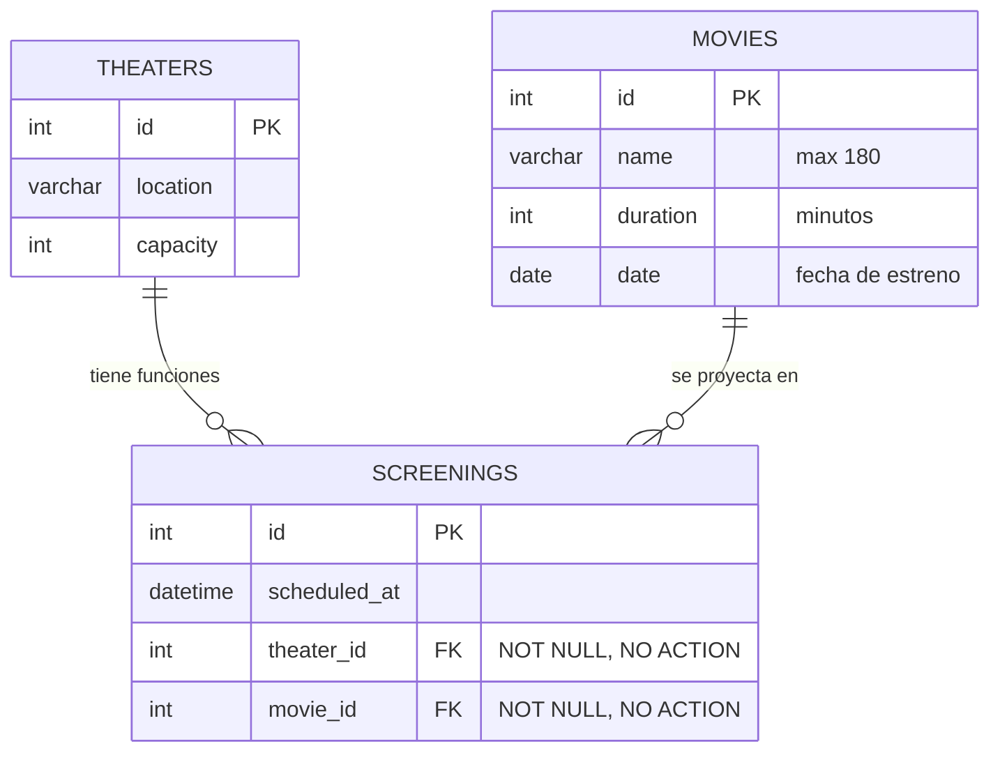

# Diseño de Persistencia 004: Tablas `movies` y `screenings` (N-N)

**Motor:** MySQL (InnoDB)  
**Base de datos:** `cinema_db`  
**Migración:** `src/migrations/1793280396192-InitCinemaSchema.ts` (ya ejecutada)

---

## 1. Diagrama Entidad-Relación



---

## 2. Diccionario de datos

### Tabla `movies`
| Columna | Tipo | Nulo | Restricción | Descripción |
| :--- | :--- | :---: | :--- | :--- |
| `id` | `INT` | No | `PK`, `AUTO_INCREMENT` | Identificador de la película. |
| `name` | `VARCHAR(180)` | No | — | Nombre de la película. |
| `duration` | `INT` | No | `>= 1` (validado en DTO) | Duración en minutos. |
| `date` | `DATE` | No | Fecha ISO (validado en DTO) | Fecha de estreno. |

### Tabla `screenings`
| Columna | Tipo | Nulo | Restricción | Descripción |
| :--- | :--- | :---: | :--- | :--- |
| `id` | `INT` | No | `PK`, `AUTO_INCREMENT` | Identificador de la función. |
| `scheduled_at` | `DATETIME` | No | — | Fecha y hora de la función. |
| `theater_id` | `INT` | No | `FK -> theaters(id)`, `ON DELETE NO ACTION` | Sala de la función (se puede repetir). |
| `movie_id` | `INT` | No | `FK -> movies(id)`, `ON DELETE NO ACTION` | Película de la función (se puede repetir). |

> No hay `UNIQUE` en `theater_id` ni en `movie_id`, porque ambos valores se repiten.

---

## 3. DDL

```sql
CREATE TABLE `movies` (
  `id` int NOT NULL AUTO_INCREMENT,
  `name` varchar(180) NOT NULL,
  `duration` int NOT NULL,
  `date` date NOT NULL,
  PRIMARY KEY (`id`)
) ENGINE=InnoDB;

CREATE TABLE `screenings` (
  `id` int NOT NULL AUTO_INCREMENT,
  `scheduled_at` datetime NOT NULL,
  `theater_id` int NOT NULL,
  `movie_id` int NOT NULL,
  PRIMARY KEY (`id`)
) ENGINE=InnoDB;

ALTER TABLE `screenings` ADD CONSTRAINT `FK_c2ba7ed0da823f76b931b3f92c6`
  FOREIGN KEY (`theater_id`) REFERENCES `theaters`(`id`) ON DELETE NO ACTION ON UPDATE NO ACTION;
ALTER TABLE `screenings` ADD CONSTRAINT `FK_540b3ebcebc8d837436ad0989bc`
  FOREIGN KEY (`movie_id`) REFERENCES `movies`(`id`) ON DELETE NO ACTION ON UPDATE NO ACTION;
```

---

## 4. Consultas SQL personalizadas

### Película más antigua (`MoviesRepository.findOldest`)
```sql
SELECT id, name, duration, date
FROM movies
ORDER BY date ASC, id ASC
LIMIT 1;
```

### Película con más funciones (`MoviesRepository.findWithMostScreenings`)
```sql
SELECT m.id, m.name, m.duration, m.date
FROM movies m
LEFT JOIN screenings s ON s.movie_id = m.id
GROUP BY m.id, m.name, m.duration, m.date
ORDER BY COUNT(s.id) DESC, m.date ASC, m.id ASC
LIMIT 1;
```

### Próximas tres funciones (`ScreeningsRepository.findNextThree`)
```sql
SELECT id, scheduled_at, theater_id, movie_id
FROM screenings
WHERE scheduled_at >= NOW()
ORDER BY scheduled_at ASC, id ASC
LIMIT 3;
```

