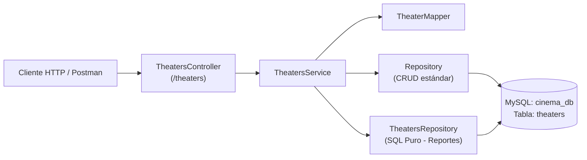

# Propuesta Técnica 001: Implementación del Primer CRUD (`Theater`) en NestJS

**Fecha:** 2026-10-29  
**Estado:** Pendiente de Aprobación  
**Módulo:** `src/theaters`

---

## 1. ¿Qué se va a hacer y Por qué?

Implementar y documentar paso a paso la guía **1 — Primer CRUD (`Theater`) en NestJS** dentro del microservicio `ms-cinema`, exponiendo los endpoints REST para la gestión de salas de cine (`theaters`) junto con un reporte personalizado en SQL puro y su respectiva documentación técnica (`docs/`).

### Hallazgo Importante en el Repositorio Actual
Al inspeccionar el repositorio clonado originalmente de `backend-ucaldas/ms-cinema`, se detectó que la rama `main` ya incluye el código acumulado de los tutoriales posteriores del curso:
- Tutorial 1: `src/theaters` (actualmente modificado con relaciones `OneToOne` y `OneToMany`)
- Tutorial 2: `src/projectors` (Relación 1 a 1)
- Tutorial 3: `src/seats` (Relación 1 a N)
- Tutorial 4: `src/movies` y `src/screenings` (Relación N a N)
- Tutorial 5: `src/common/guards/security.guard.ts` (Guardián global de seguridad)

---

## 2. Arquitectura Propuesta (`src/theaters`)

Siguiendo tal cual la guía proporcionada y respetando el límite estricto de `< 150 líneas` por archivo:

### Archivos de la Rebanada (`src/theaters/`)
| Archivo | Responsabilidad | Líneas Est. |
| :--- | :--- | :---: |
| `src/theaters/entities/theater.entity.ts` | Entidad ORM mapeada a la tabla `theaters` (`id`, `location`, `capacity`). | ~15 |
| `src/theaters/dto/create-theater.dto.ts` | Validaciones de entrada con `class-validator` (`@IsString`, `@IsInt`, `@Min(1)`, `@Max(1000)`). | ~12 |
| `src/theaters/dto/update-theater.dto.ts` | DTO parcial extendido con `PartialType(CreateTheaterDto)`. | ~5 |
| `src/theaters/dto/theater-response.dto.ts` | Contrato de salida tipado (`id`, `location`, `capacity`). | ~6 |
| `src/theaters/mappers/theater.mapper.ts` | Transformación pura entre DTOs y la entidad `Theater`. | ~35 |
| `src/theaters/repositories/theaters.repository.ts` | Consultas SQL nativas (`findLargeTheatersReport`) vía `DataSource.query`. | ~22 |
| `src/theaters/theaters.service.ts` | Lógica de negocio CRUD + invocación de reportes y control de `NotFoundException`. | ~66 |
| `src/theaters/theaters.controller.ts` | Endpoints REST (`POST`, `GET`, `PATCH`, `DELETE`, `GET reports/large/:minCapacity`). | ~42 |
| `src/theaters/theaters.module.ts` | Registro modular de entidad, servicio, mapper y repositorio personalizado. | ~16 |

---

## 3. Documentación a Generar (`docs/`)

Además de aplicar la guía en el código, se generará la documentación técnica completa en `docs/`:
1. **`docs/architecture/001-theaters-crud-architecture.md`**: Diagrama de componentes, flujo de datos (Mermaid) y ADR del diseño del módulo `theaters` (separación de `Repository<Theater>` para CRUD y `TheatersRepository` para SQL puro).
2. **`docs/database/001-theaters-schema.md`**: Diccionario de datos y DDL SQL de la tabla `theaters`.
3. **`docs/api/001-theaters-endpoints.md`**: Especificación detallada de todos los endpoints (`POST /theaters`, `GET /theaters`, `GET /theaters/:id`, `PATCH /theaters/:id`, `DELETE /theaters/:id`, `GET /theaters/reports/large/:minCapacity`), ejemplos de payloads JSON, respuestas esperadas y códigos de estado HTTP (`200`, `201`, `400`, `404`).

---

## 4. Decisión Requerida para la Ejecución

Dado que el proyecto clonado ya trae código de los tutoriales 2 al 5, necesitamos confirmar si deseas:
1. **Dejar el código exactamente en el estado del Tutorial 1 ("tal cual la guía"):** Aislar `theaters`, `app.module.ts` y `main.ts` exactamente como indica la guía 1 (sin las relaciones con `Projector`, `Seat`, `Screening` ni el `SecurityGuard` global, para que puedas probar los endpoints de `theaters` sin que te pida token de seguridad ni falle por tablas adicionales).
2. **Conservar los módulos de los tutoriales 2–5:** Mantener las relaciones actuales en `theaters` y solo generar la documentación completa del Tutorial 1.

